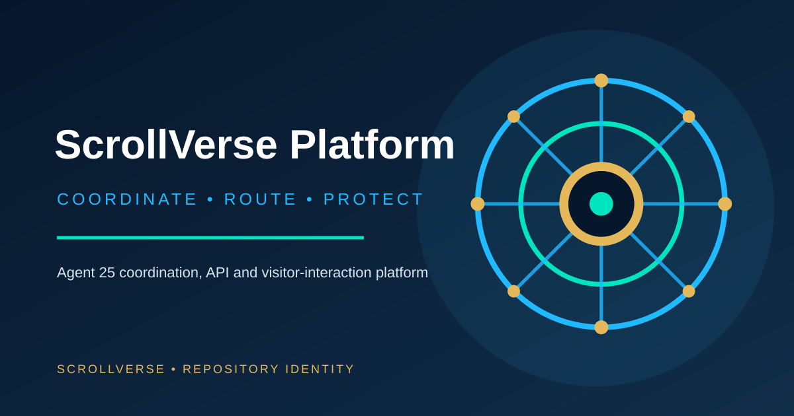

# ScrollVerse Platform — Agent 25 Coordination Core

**Specialization:** coordination APIs, visitor interaction, security controls, and health/heartbeat services.

This repository contains the ScrollVerse Platform service layer, including Agent 25 routing and visitor-facing integration components. Agent 25 coordinates system connections while each Legion intelligence retains its own identity, scope, and permission boundary.

## Source map
- `server/agent25.router.ts` — Agent 25 request routing
- `server/agent25.security.ts` — security policy
- `server/agent25.rate-limit.ts` — request limits
- `server/_core/heartbeat.ts` — service heartbeat
- `client/src/components/Agent25VisitorChat.tsx` — visitor interaction

## Repository identity
- Sigil: `identity/sigil.svg`
- Logo: `identity/logo.svg`
- Thumbnail: `identity/thumbnail.svg`
- Specialist profile: `identity/specialist-profile.json`

## Operating boundary
The specialist profile is drafted, not evidence of a continuously running autonomous agent. Changes are proposed through feature branches and pull requests. No default-branch writes, production deployment, secret access, or permission grants are authorized by this profile.

**Trademark status:** proposed identity; official clearance and registration have not been researched or claimed.
